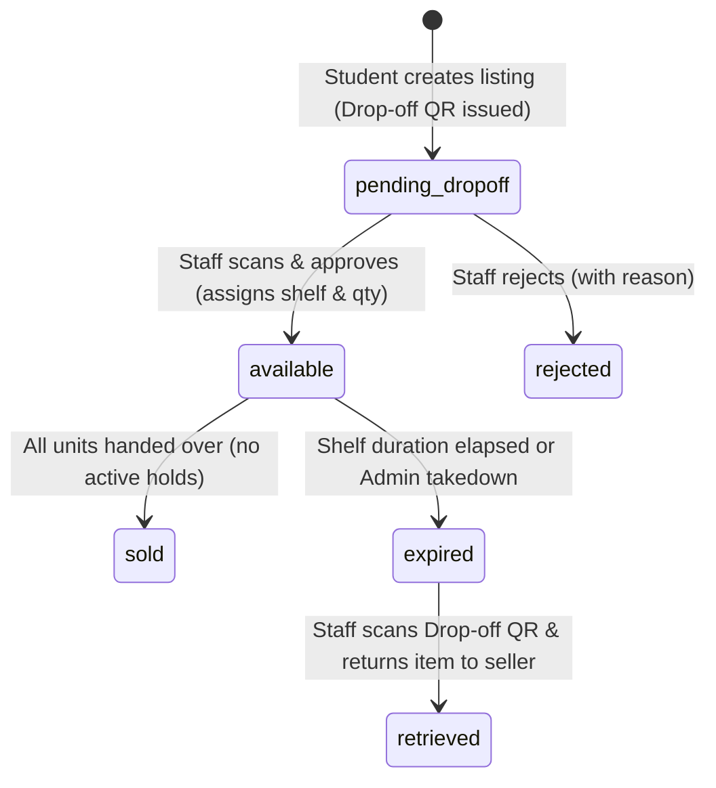
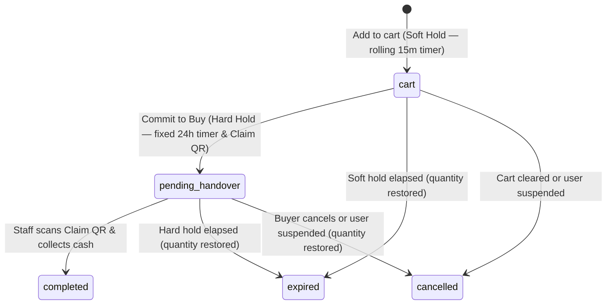
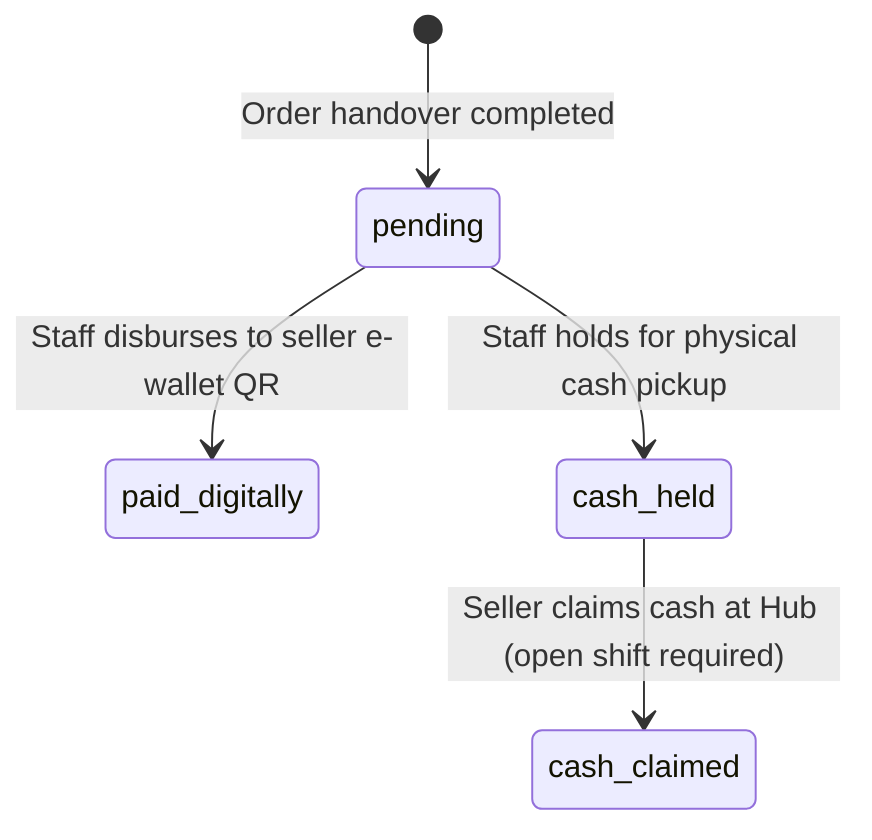

# UniMart — Campus Buy & Sell Consignment Hub

UniMart is a centralized, closed-loop buy-and-sell web application designed exclusively for the university ecosystem. It facilitates the safe, scam-free exchange of pre-owned academic materials and campus gear—such as Physical Education equipment, college-specific uniforms, calculators, and textbooks—through a staff-operated physical **Campus Hub**.

Instead of peer-to-peer meetups prone to flaking and fraud, all physical items and cash payments pass through the Campus Hub using a QR-code-driven consignment workflow.

---

## Core Features

- **Unified Student Profiles**: Every verified student account can seamlessly buy and sell from a single profile, manage active listings and cart reservations, and configure a universal EMVCo e-wallet QR code for payouts.
- **QR-Driven Physical Consignment**:
  - **Drop-off QR**: Generated when a student lists an item. Hub Staff scan the ULID QR code to inspect, verify quantity, assign a shelf location, print physical tracking tags, and approve or reject the item.
  - **Claim QR**: Generated when a buyer commits to purchase. Hub Staff scan the Claim QR to collect cash payment and complete the physical handover.
- **Two-Stage Reservation System**:
  - **Soft Hold (Cart)**: Adding an item to the cart immediately reserves the quantity with a rolling countdown (default: **15 minutes**). The timer refreshes automatically while the student remains active in the app.
  - **Hard Hold (Commit to Buy)**: Checking out converts the cart into a committed order with a strict, non-extendable countdown (default: **24 hours**) to visit the Hub and pay in cash.
  - **Automatic Release**: If either hold expires, reserved quantities are automatically restored to the public catalog via both lazy evaluation and scheduled background commands.
- **Dual-Payout System**: Once an order is handed over, Staff can disburse seller proceeds either:
  - **Digitally**: Immediately via the seller's saved e-wallet QR code (GCash / Maya / EMVCo).
  - **Hold for Cash Claim**: Held at the Hub for physical cash pickup by the seller (preserving desk drawer liquidity), with optional hold reasons.
- **Shift Lifecycle & Cash Drawer Reconciliation**: Cash-moving desk operations (completing buyer claims and releasing held cash payouts) require an open Staff shift. Opening a shift records the starting cash float, and closing a shift automatically calculates `expected_cash` against `actual_cash` for audit compliance.
- **Role-Based Access Control & Immutable Auditing**:
  - **Students**: Unified buyer/seller portal, catalog filtering by college/program, in-app messaging with item sellers, notification inbox, and dispute reporting.
  - **Staff**: Desk scanner portal, drop-offs, buyer claims, expired item retrievals, payouts, and shift drawer counts, governed by granular operational permissions.
  - **Admins**: System timer configuration, financial summaries, shift discrepancy audits, staff permission management, category hierarchy CRUD, inventory takedowns, user moderation (suspension), and report resolution.
  - Every Hub and administrative action is recorded in an immutable activity log (`hub` channel).

---

## Domain Lifecycles

### Item Lifecycle



### Order Lifecycle



### Payout Lifecycle (Per Order Item)



---

## Tech Stack

| Layer | Technologies |
| :--- | :--- |
| **Backend** | PHP 8.5, Laravel 13, Laravel Fortify (Authentication & 2FA), Inertia.js v3 |
| **Authorization & Auditing** | Spatie Laravel Permission v8, Spatie Laravel Activitylog v5 |
| **Frontend** | React 19, TypeScript 5.7, Tailwind CSS v4, Radix UI / shadcn/ui, Lucide Icons, `html5-qrcode` |
| **Routing & Bundling** | Laravel Wayfinder (typed routes/actions), Vite 8 (`vite-plus`) |
| **Database & Cache** | MySQL 8.4 / SQLite, Redis |
| **Testing & Quality** | Pest v5, Larastan (PHPStan), Laravel Pint |

---

## Getting Started

### Prerequisites

- **PHP 8.3+** (PHP 8.5 recommended / included in Sail runtime)
- **Composer**
- **Node.js 22+** & **npm**
- **Docker** (optional, if running via Laravel Sail)

### Option 1: Local Quick Setup

Run the built-in composer setup script to install dependencies, initialize `.env`, generate an app key, run migrations, and build frontend assets:

```bash
composer run setup
```

Seed the database with roles, permissions, university categories, and demo marketplace data:

```bash
php artisan db:seed
```

Start the local development server (runs Laravel server, queue listener, Pail logs, and Vite HMR concurrently):

```bash
composer run dev
```

### Option 2: Docker (Laravel Sail)

The repository includes a `compose.yaml` configured with PHP 8.5, MySQL 8.4, and Redis.

1. Copy the environment configuration:
   ```bash
   cp .env.example .env
   ```
2. Update `.env` database settings if using the Sail MySQL container:
   ```dotenv
   DB_CONNECTION=mysql
   DB_HOST=mysql
   DB_PORT=3306
   DB_DATABASE=unimart
   DB_USERNAME=sail
   DB_PASSWORD=password
   ```
3. Start the containers:
   ```bash
   ./vendor/bin/sail up -d
   ```
4. Install dependencies, migrate, and seed:
   ```bash
   ./vendor/bin/sail composer install
   ./vendor/bin/sail artisan key:generate
   ./vendor/bin/sail artisan migrate --seed
   ./vendor/bin/sail npm install
   ./vendor/bin/sail npm run dev
   ```

Default Sail port mappings from `compose.yaml`:
- **Web App**: `http://localhost:81` (`APP_PORT=81`)
- **Vite Dev Server**: `5174` (`VITE_PORT=5174`)
- **MySQL**: `3307` (`FORWARD_DB_PORT=3307`)
- **Redis**: `6380` (`FORWARD_REDIS_PORT=6380`)

---

## Demo Credentials

Running `php artisan db:seed` executes `DemoMarketplaceSeeder`, which provisions ready-to-use accounts across all roles (all using password `password`):

| Role | Name | Email | Password | Notes |
| :--- | :--- | :--- | :--- | :--- |
| **Admin** | Campus Admin | `admin@unimart.test` | `password` | Full oversight, settings, audits, user & staff management |
| **Staff** | Campus Hub Staff | `staff@unimart.test` | `password` | Pre-granted desk operational permissions & sample open shift |
| **Student** | Maria Santos | `student1@unimart.test` | `password` | Active listings, sales, and configured GCash QR |
| **Student** | Juan Dela Cruz | `student2@unimart.test` | `password` | Active listings, pending claims, and configured Maya QR |
| **Student** | Alyssa Valdez | `student3@unimart.test` | `password` | Active cart, completed purchases, and configured GCash QR |

---

## Configuration & Scheduled Tasks

### Environment Variables

In addition to standard Laravel variables, UniMart supports restricting registration to specific university email domains in `.env` (configured in `config/unimart.php`):

```dotenv
# Comma-separated list of allowed university domains (leave empty to allow any valid email)
UNIMART_ALLOWED_EMAIL_DOMAINS=university.edu.ph,student.university.edu.ph
```

### Dynamic System Timers

Administrators can adjust hold and expiration timers at runtime via **Admin → Settings** (`/admin/settings`), backed by `App\Enums\SettingKey`:

- `cart_soft_hold_minutes`: Default `15` (range: `5–120` minutes)
- `order_hard_hold_hours`: Default `24` (range: `1–168` hours)
- `item_shelf_expiry_days`: Default `30` (range: `7–365` days)

### Scheduled Commands

Defined in `routes/console.php` (run via `php artisan schedule:work` locally or cron in production):

| Command | Frequency | Description |
| :--- | :--- | :--- |
| `unimart:release-expired-carts` | Every minute | Releases expired cart soft holds and restores item quantities |
| `unimart:expire-hard-holds` | Every minute | Expires overdue `pending_handover` claims, restores quantities, and notifies buyers |
| `unimart:expire-shelf-items` | Hourly | Marks unsold items past their shelf duration as `expired` (skipping items with active holds) |

---

## Testing & Quality Assurance

Run the Pest test suite:

```bash
php artisan test --compact
```

Run code formatting, static analysis, and frontend checks:

```bash
# Format PHP code with Laravel Pint
composer run lint

# Run PHPStan / Larastan static analysis
composer run types:check

# Run frontend formatting/linting and TypeScript type-checking
npm run check
npm run types:check

# Run full CI check suite (frontend checks + Pint + PHPStan + Pest tests)
composer run ci:check
```

---

## Project Structure Highlights

- `app/Actions/` — Domain business logic organized into single-purpose action classes (`Admin`, `Cart`, `Fortify`, `Listings`, `Messaging`, `Orders`, `Payouts`, `Reports`, `Shifts`, `Staff`).
- `app/Enums/` — Strongly-typed domain enums (`HubEvent`, `ItemCondition`, `ItemStatus`, `OrderStatus`, `PayoutHoldReason`, `PayoutStatus`, `ReportStatus`, `SettingKey`).
- `app/Http/Controllers/` — Role-segmented Inertia controllers (`Student`, `Staff`, `Admin`, `Settings`).
- `app/Support/HubAudit.php` — Centralized helper recording structured activity logs onto the `hub` audit trail.
- `resources/js/pages/` — Inertia React page components organized by portal (`student/`, `staff/`, `admin/`, `settings/`, `auth/`).
- `docs/` — Concept paper (`docs/concept-v3.md`), DBML database schema (`docs/schema.dbml`), and phase implementation specifications.
